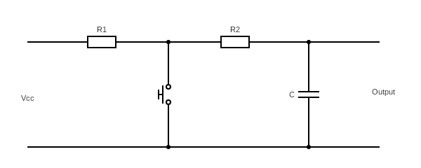
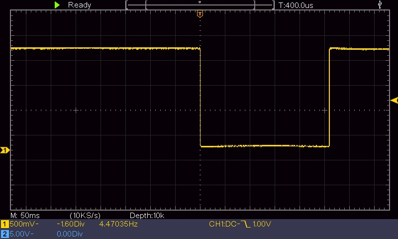
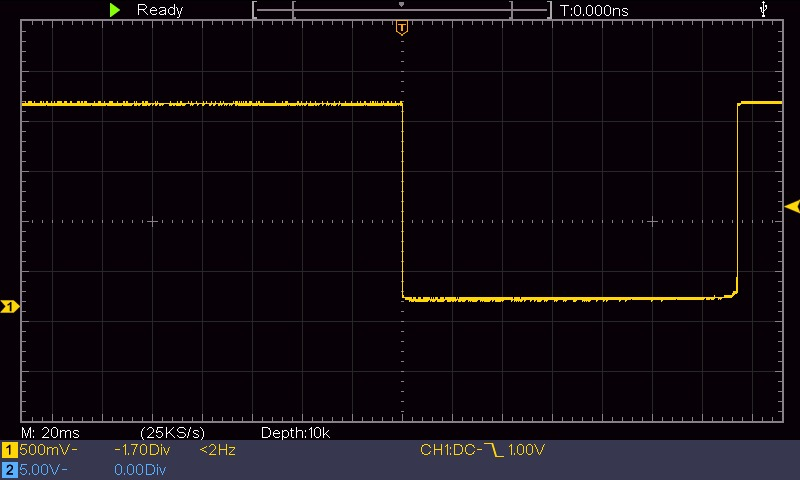
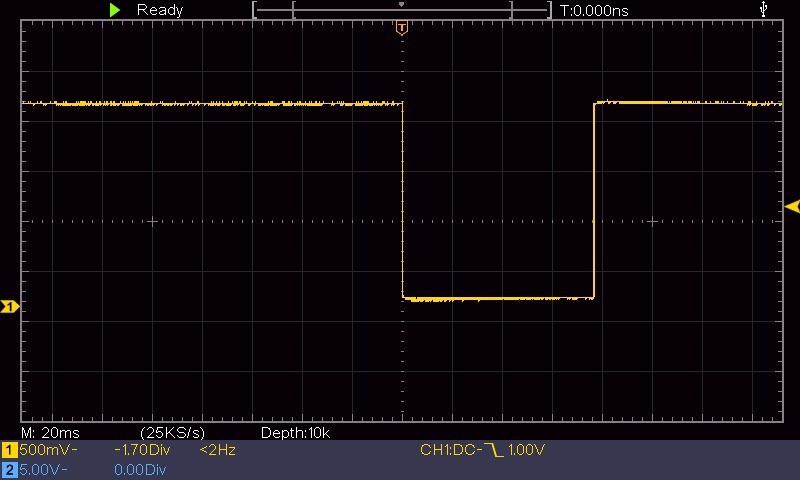
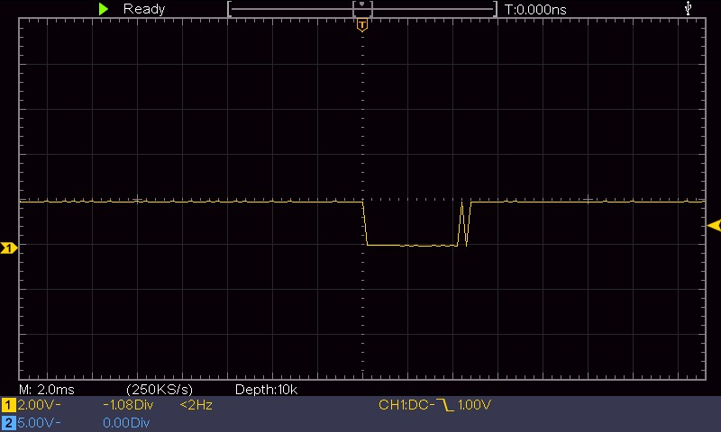
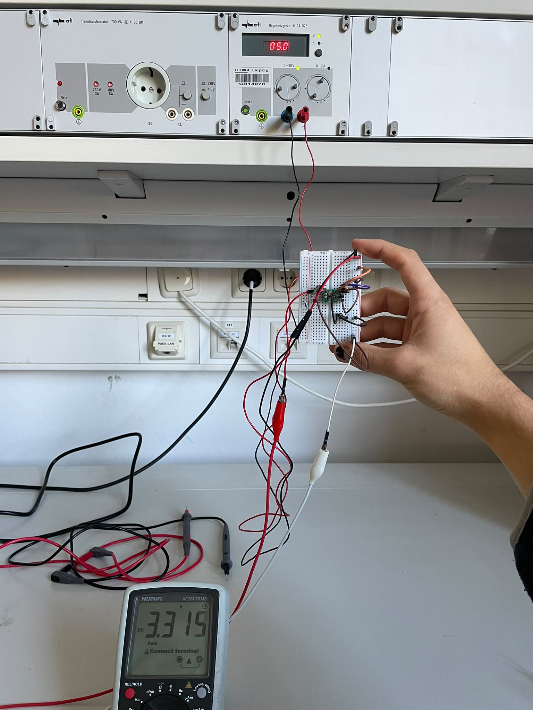
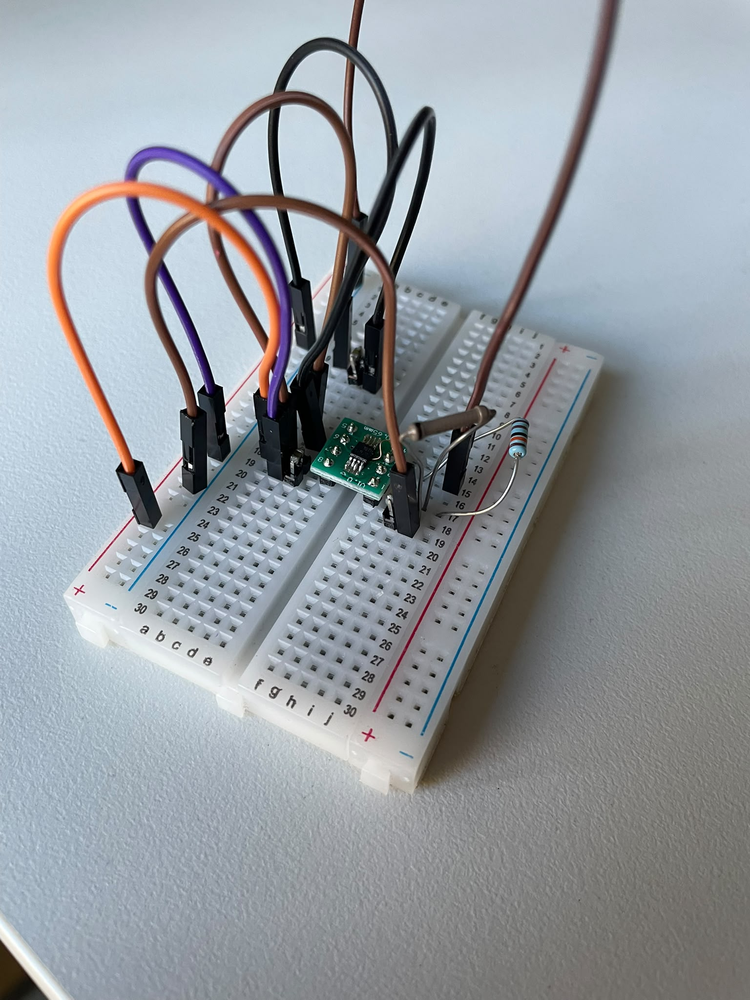
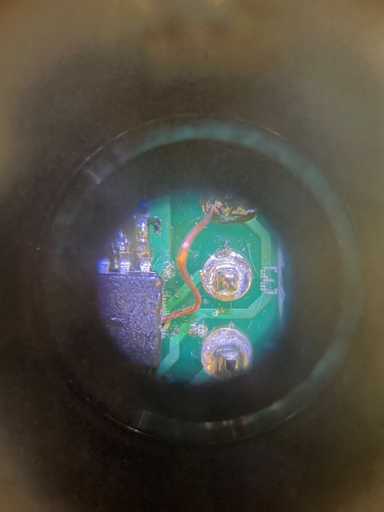

# Pseudo-random electronic die with a linear voltage regulator and hardware debouncing

This project and this README is/will be broken up into 4 parts:

1. Schematic
2. Code and register setup 
3. Debounce design 
4. LDO voltage regulator 

---

### Schematic


### Registers used, and why

```c
    DDRB    = 0b00000111;              
    PORTB   = 0b00001000;             
    PRR     = 0b00001010;             
    ADCSRA  = 0b10000110;             
        
    GIMSK |= (1 << PCIE);              
    PCMSK |= (1 << PCINT3);            
    MCUCR |= (1 << SE) | (1 << SM1);     
    ADMUX |= (1 << MUX1);                
    sei(); 
```

| Register | Bit(s) | Reason |
|----------|----------|----------|
| DDRB     | 0-2     | Pins 0, 1 & 2 of port B are set to outputs, as these are the pins which the seven LEDs are connected to    |
| PORTB    | 3       | Port B pin 3 set to high to activate the pull-up resistor  |
| PRR      | 1, 3    | Here bits PRUSI and PRTIM1 are set to 1 to reduce clock related power consumption to periphery hardware (timers and serial interfaces). Important to note here is that bit 0 is not set, that would disable the ADC.  |
| ADCSRA   | 1, 2    | Setting bits [2:0] to 110 sets the division factor between the system clock frequency (1MHz) and the input clock to 64. This means the ADC input clock (derived from the CPU frequency) runs at $\frac{1\text{MHz}}{64} = 15.6 \text{kHz}$. This is below the reccomended range, poses no issue though, as I want the ADC readings to be noisy.  |
| GIMSK    | PCIE    | INT0 bit is NOT set, because a distinction between rising and falling edges is not needed (more on that later). The PCIE bit enables pin-change-interrupts    |
| PCMSK    | PCINT3  | Here the *Pin Change Mask* Pin-Change-Interrupt pin 3 is enabled. This means pin 3 will trigger an interrupt.     |
| MCUCR    | SE, SM1 | Bit SE must be enabled for the MCU to enter sleep mode. Setting bits [SM1:SM0] to 10  enables the power-down sleep mode.    |
| ADMUX    | MUX1    |   Setting bits [MUX3:MUX0] to 0010 selects PB4 as our analog input (which is connected to the ADC).   |

sei() is a AVR specific function which sets *Global Interrupt Enable*


#### Thought process behind the code:

Under power the microcontroller is permanetly in a power-down sleep mode **UNTIL** a pin change (PB3 is pulled low via a push button) is detected;  after which an ISR function is run in which the following happens:

1. only executes the IRQ code if the pin change was a falling edge (this was why INT0 is not needed, i can just use software, furthermore INT0 interrupts are hardwired to PB2 and that would mean i need to change the schematic ect.).
2. ADC is reenabled
3. A for-loop reads the LSB form PB4 eight times to create a pseudo random 8-bit seed
4. ADC is disabled
5. run a function to light up 1-6 LEDs depending on what seed is given

## Debounce design (with (assumed) $t_{bounce} = 20 \text{ms}$)

 

*chosen debounce circuit*

When the button is not pressed, the output is HIGH (Vcc). When pressed the capacitor discharges over R2.

From the datasheet: 
- the highest values at which PB3 is guaranteed to read low is 0.33V
- the lowest values at which PB3 is guaranteed to read HIGH is 2.3V

In practice this means the pin will probably read 0 below 2.3V and definitely read 0 below 0.33V. 

Formally this means that 
$$
U_c(20 \text{ms}) = 2.3\text{V} = 3.3 \text{V} \cdot e^{- \frac{20 \text{ms}}{R_2 \cdot C}}
$$
must hold trueeee. Selecting $\text{C} = 100 \text{nF}$ we get $$ R_2 = -\frac{20 \text{ms}}{100\text{nF}\cdot \text{ln}(\frac{2.3}{3.3})} \approx 555\text{k} \Omega. $$
With a leakage of $1\mu\text{A}$ this would result in a non-negligible voltage difference over $R_1 + R_2$. If we select $C= 10 \mu F$ we get $R_2 = 5.5k \Omega$, much better.   

 
## Testing the button without debouncing hardware

### Firm button press -> 260ms


 


### Normal button press -> 130ms

 

### quick(ish) button press press -> 75ms




### 5ms button press achieved only after multiple attempts with finger-nail-sliding-off technique




As can be seen in these test, the button I chose does not bounce. How fortunate I am. Let this be a lesson in "test **then** parameterise". A singular rebound can be seen on button release in the last image, this is a non-issue, as if it occurs within 20ms then it will not even register. 

## TPS7A49 Positive Linear Regulator

quick backround on the IC. After reading the datasheet the design essentially boils down to correctly selecting the two resistors and making sure that:
- The PowerPAD is tied directly to GND
- Low ESR X7R or X5R ceramic capacitors (preferably 10 $\mu F$) 
- EN is tied to IN ($V_{in} > V_{EN}$ was given)
- NR/SS is not resistively or inductively loaded. 

The datasheet specified that, for no-load conditions, 

$$\frac{V_{ref(max)}}{R_2} > 5\mu A$$

 must hold true. This means that $R_2$ must be smalle than $242\text{k}\Omega$. Selecting $R_2 = 110\text{k}\Omega$ gives us

 $$R_1 = R_2(\frac{V_{out}}{V_{FB(NOM)}}-1) \approx 200 \text{k}\Omega$$

 for $R_2$. With all that I soldered the TPS7A49 onto a breadoutboard, my SMD capacitors between pins and tested it.  

 ### It works


 

 ### IC/Breadboard closeup


 


 ### PowerPAD tied to GND
 


